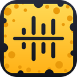

# ActionCheese Sync

Waveform-based multicam sync for **FCP7 XML (`xmeml`)** timelines — an open, scriptable
equivalent of PluralEyes 4 / Syncaila.

Companion to **ActionCheese — Multicam Remote**: record the takes there, sync the timeline
here.

Feed it a timeline exported from Premiere Pro (or Resolve, or Media Composer) with one
camera or recorder per track, **or just the folders off the cards** — one per camera — or
any mix of the two. It analyses the audio, works out where every clip really belongs, and
writes a timeline with everything in sync. Clips it cannot match are never dropped — they
are moved onto newly created tracks placed after the last synced clip.

Material that arrives already synced, such as an ActionCheese shoot recorded by several
phones against one shared clock, keeps its relationships without being re-measured.

## Download

**[Download ActionCheese Sync for Mac](https://github.com/dev-actioncheese/actioncheese-sync/releases/latest)** — free,
Apple silicon, macOS 11 or later. Product page and full help:
[actioncheese.com/sync.html](https://actioncheese.com/sync.html).

The app isn't signed by Apple yet, so macOS asks once before the first launch:

- **macOS 15 Sequoia and later:** open it, click **Done** on the warning, then go to
  **System Settings › Privacy & Security**, scroll to *ActionCheese Sync was blocked* and
  click **Open Anyway**.
- **macOS 14 and earlier:** right-click the app in Applications, choose **Open**, then
  **Open** again.

## Requirements

- Python 3.10+
- `ffmpeg` and `ffprobe` on `PATH` (`brew install ffmpeg`)

## Install

```bash
uv venv && uv pip install -e ".[dev]"
```

## Desktop app (macOS)

```bash
packaging/build_app.sh                # bundles ffmpeg -> runs on any Mac
packaging/build_app.sh --no-ffmpeg    # smaller; recipient must have ffmpeg
```

Produces `dist/ActionCheese Sync.app` (~120 MB bundled). To share it:

```bash
ditto -c -k --keepParent "dist/ActionCheese Sync.app" dist/ActionCheeseSync-mac.zip
```

The app is unsigned, so on another Mac the first launch needs the steps under
[Download](#download) (or `xattr -dr com.apple.quarantine "/Applications/ActionCheese Sync.app"`).

The bundle also carries the CLI:

```bash
"ActionCheese Sync.app/Contents/MacOS/ActionCheese Sync" --cli sync in.xml -o out.xml
```

> **Licence note:** Homebrew's ffmpeg is built with GPL components, so a bundled build is
> subject to the GPL — anyone you give it to is entitled to the corresponding source. This
> project is GPL-3.0 and its source is this repository; the bundled ffmpeg is Homebrew's
> build of the upstream release, whose source is at <https://ffmpeg.org/download.html> and
> <https://github.com/Homebrew/homebrew-core/blob/master/Formula/f/ffmpeg.rb>.

Run the GUI from a checkout with `actioncheese-sync-gui`.

## Use

Export your timeline from Premiere with **File → Export → Final Cut Pro XML**, then:

```bash
actioncheese-sync sync timeline.xml -o timeline-synced.xml --report report.json
```

### Folders instead of, or alongside, a timeline

Inputs are positional and can be mixed freely. A folder is **one camera or recorder** —
nested card structure does not matter, everything under it belongs to that device:

```bash
actioncheese-sync sync ~/cards/cam-a ~/cards/cam-b ~/cards/recorder -o synced.xml
```

Three kinds of input are recognised:

| Input | Treated as |
|---|---|
| `.xml` (FCP7 / xmeml) | A timeline; its clips keep their positions |
| An ActionCheese shoot folder (has `.saycheese-shoot.json`) | One device per phone, already in sync with each other; camera folders nested inside it are picked up as further devices |
| Any other folder | One device; clips ordered by when they were recorded |

Recording times come from a Sony card's own `*M01.XML` clip sidecar where there is one —
it records the moment recording started, and reading it is both faster and more
trustworthy than probing the movie — and from the container's `creation_time` otherwise.

```bash
# a shoot folder with the cards dropped inside it: one argument does the lot
actioncheese-sync sync /Volumes/T7/actioncheese/2026-09-27 -o synced.xml

# see what would be read, without analysing anything
actioncheese-sync probe /Volumes/T7/actioncheese/2026-09-27
```

**One timeline on its own** is edited in place: its document is copied and only numbers in
it change, so every Premiere-specific detail survives. **Anything else** has to be
assembled into a new timeline — clips keep their media, in and out points and positions,
but effects, labels and speed changes on them do not carry over.

### Markers

Markers come across and **follow the clip they were made on**, so they still mark the same
moment after everything has moved. A marker made between takes keeps its distance from the
takes either side.

Markers from an ActionCheese shoot follow that shoot's own cameras, never a camera card:
the shoot's clock is the one that timed them, so anchoring one to a card whose clock was
40 s out would drag it 40 s off when that card is moved into place.

### Clips that arrive already in sync

Stated timings are treated as **strong evidence, not as fact**: where a confident audio
match disagrees, the audio wins. Measured against the ActionCheese app's own shoot index
on two real shoots, its clip starts were good to about 0.03 s for most phones — but one
handset was out by up to 0.7 s, which the audio caught and corrected. Pass
`--trust-synced` to keep the stated timing exactly instead.

Either way the report lists every already-synced clip the audio moved, and by how much, so
the accuracy of whatever produced those timings is visible rather than assumed.

Import `timeline-synced.xml` back into Premiere (**File → Import**).

Inspect a timeline without analysing anything:

```bash
actioncheese-sync probe timeline.xml
```

Analyse and report without writing an output file:

```bash
actioncheese-sync sync timeline.xml --dry-run
```

### Options

| Flag | Default | Meaning |
|---|---|---|
| `-o, --output` | — | Output XML path (omit with `--dry-run`) |
| `--report` | — | Write a JSON report of every decision |
| `--sequence-name` | — | Name for the output sequence |
| `--sequence-suffix` | `_synced` | Appended to the sequence name when `--sequence-name` is unset |
| `--unsynced-placement` | `inline` | `inline` drops each unmatched clip in after everything shot before it; `append` puts them all at the end |
| `--unsynced-label` | `Rose` | Label colour for unmatched clips (Premiere's red is Rose); `''` disables |
| `--close-gaps` | off | Remove every stretch where nothing plays on any track |
| `--reference` | auto | Track to hold still, e.g. `V1`, `A3`. Defaults to the track with the most matched material |
| `--min-confidence` | `0.45` | Minimum correlation to accept a match |
| `--min-peak-ratio` | `1.0` | Peak-to-runner-up ratio floor (off by default; see below) |
| `--unsynced-gap` | `1.0` | Seconds of gap before the unsynced block |
| `--islands` | `append` | `append` keeps internally-synced groups together after the main block; `unsynced` treats them as orphans |
| `--no-drift` | off | Detect drift but never write speed corrections |
| `--drift-threshold-ppm` | `5.0` | Minimum drift before a correction is applied |
| `--drift-min-duration` | `300` | Shortest clip (seconds) eligible for drift analysis |
| `--media-root` | — | Directory to re-locate media in when paths in the XML are stale |
| `--jobs` | CPU count | Parallel decode workers |
| `--cache-dir` | `~/.cache/syncmyvids` | Where onset envelopes are cached |
| `--rate FPS` | most common | Frame rate for a timeline built from folders |
| `--trust-synced` | off | Keep stated timings for already-synced clips instead of letting audio correct them |
| `--built-xml PATH` | — | Also save the timeline assembled from the inputs, before syncing |

## How it works

1. **Parse** the xmeml with `lxml`. Clips linked by `<link>` (a camera's picture plus its
   own audio) are grouped into rigid *sync units* that always move together.
2. **Extract features.** Each unit's audio is decoded to mono at 8 kHz and reduced to a
   per-band spectral-flux onset envelope at 100 Hz. Each band is standardised
   independently, so a camera mic and a lav on a field recorder become comparable
   despite completely different frequency response.
3. **Match all pairs** by normalised cross-correlation, normalising each lag by the energy
   of the genuinely overlapping region. The winning lag is chosen on a length-penalised
   score (`coefficient × √overlap`), because a brief overlap can correlate *perfectly* by
   coincidence — one clip's tail against another's head — and would otherwise outrank the
   long, slightly noisier, obviously correct alignment. A match is accepted on both its
   correlation coefficient and its peak-to-runner-up ratio.
4. **Refine** accepted pairs with GCC-PHAT on raw audio, taking the offset from 10 ms
   resolution down to well under a sample.
5. **Reject impossible pairs.** Two clips on the same track are the same physical
   device, which cannot record the same moment twice, so they are never matched. On real
   footage two sequential takes from one camera correlate at ~0.5 from shared room tone
   and music alone, and the solver would otherwise average that impossible constraint
   into the true chain.
6. **Solve globally.** Units are nodes and accepted offsets are weighted edges. Connected
   components are found by union-find; within each, a maximum-confidence spanning tree
   seeds positions and a weighted least-squares pass reconciles every edge at once, so no
   single bad pairwise match can drag a clip out of place. One reweighting pass demotes
   inconsistent edges, which are surfaced in the report as conflicts.
7. **Lay out** the result: matched units are repositioned (the reference track stays put),
   and unmatched ones move to fresh tracks starting after the last synced clip.

### Drift

Recorders' clocks diverge — a field recorder can drift tens of milliseconds per hour
against a camera. For long clips, the offset is measured in five 60-second windows spread
across the clip and a weighted least-squares line is fitted through them; the slope is the
drift rate, reported in ppm for every clip, relative to the reference device.

Two details make this work, both learned the hard way on the test footage:

- **Probes match on onset envelopes, not raw waveforms.** Raw cross-correlation between
  two different microphones is multi-peaked — the true peak scores 0.41 against a
  competing peak at 0.31 — so per-window raw matching jumps between peaks and the slope
  becomes noise. Envelopes score ~0.85 with a single clear peak.
- **The probe envelope rate is 400 Hz, four times the matching rate.** Drift is a
  millisecond-scale effect measured over minutes; at 100 Hz the quantisation alone costs
  about a quarter of the answer (measured 14 ppm against a true 20).

The fit's own residual is the quality gate: if the line misses its probes by more than
10 ms, the measurement is reported but no correction is written.

Corrections are applied **only to standalone audio-recorder clips** — never to camera
clips, so picture is never resampled. A correction is written as a Premiere-style
`timeremap` filter, maintaining the invariant `(out - in) == round((end - start) × speed)`
that Premiere requires before it will honour a speed effect.

On the bundled fixtures this recovers **+19.3 ppm against a true +20 ppm**, and reads
**−0.4 ppm** for the drift-free camera.

## Tests

```bash
pytest
```

The end-to-end tests build synthetic media on first run (a few seconds, needs `ffmpeg`)
from one master "room recording" that each simulated device captures a different window
of, through a different simulated microphone — so the true alignment is known exactly and
the assertions check against it rather than against a previous run's output. The scenario
and its ground truth live in `tests/fixtures/make_fixtures.py`.

## Limitations

- FCP7 XML only. Final Cut Pro X `.fcpxml` is a different format and is rejected with a
  clear message (Premiere cannot import it either).
- Sync is audio-based; a clip with no usable audio cannot be matched and becomes an orphan.
- Clips abutting transitions (xmeml writes `-1` for `start`/`end`) are left where they are
  and reported, since their real position depends on the neighbouring transition.

## Help and support

In the app: **Help → ActionCheese Sync Help**, or **Help → About**. From a terminal:

```bash
actioncheese-sync guide     # what each option does, and how to read the result
actioncheese-sync about     # version, author, contact
```

Bugs, sample projects and testing feedback: **dev@actioncheese.com**

Anything else: **contact@actioncheese.com**

## Licence

Two works, two licences — see **[LICENSING.md](LICENSING.md)** for the scope and the
reasoning. Copyright © 2026 Gabriel (Focalizat).

| Path | Licence |
|---|---|
| `src/`, `packaging/`, `tests/`, the macOS app | [GPL-3.0-or-later](LICENSE) |
| [`swift/ActionCheeseSyncKit/`](swift/ActionCheeseSyncKit) | [MIT](swift/ActionCheeseSyncKit/LICENSE) |

The app is GPL because it bundles a Homebrew build of ffmpeg, which is GPL-bound;
publishing this source is what makes distributing that bundle legitimate.

The Swift package is MIT because it has no ffmpeg dependency and no third-party
dependencies at all — original code over AVFoundation and Accelerate. That is what lets
an App Store app link it: GPLv3 cannot be satisfied under Apple's Licensed Application
EULA, and MIT can. Every source file carries a matching SPDX identifier.

## Author

**Gabriel** — [Focalizat](mailto:contact@actioncheese.com)

Please report bugs to dev@actioncheese.com, attaching the timeline XML and the log
text if you can.

## Prior art

The envelope-correlation approach follows [align-videos-by-sound](https://github.com/align-videos-by-sound/align-videos-by-sound)
and [audalign](https://github.com/benfmiller/audalign); GCC-PHAT is standard practice in
time-delay estimation. Element semantics come from Apple's
[FCP7 XML Interchange Format](https://developer.apple.com/library/archive/documentation/AppleApplications/Reference/FinalCutPro_XML/Elements/Elements.html)
reference.
